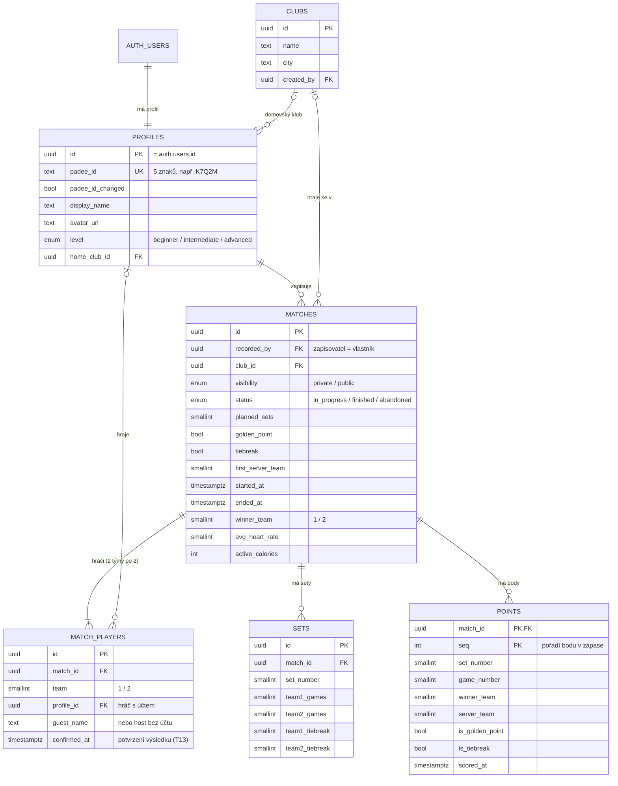

# PADEE – datový model (Supabase)

Databáze v Supabase (PostgreSQL). Tabulky vznikají SQL migracemi ve složce [`supabase/migrations/`](../supabase/migrations/), bezpečnostní pravidla (RLS) jsou v druhé migraci. Model vychází z [uživatelských cest](uzivatelske-cesty.md).

## ER diagram

## Proč je to takhle

| Rozhodnutí | Důvod |
| --- | --- |
| Profil vzniká sám po registraci | Trigger `on_auth_user_created` založí profil a přidělí náhodné PADEE ID, aplikace nemusí nic řešit. |
| Tabulka `match_players` navíc | Zápas jsou 2 týmy po 2 a zapisovatel po zápase přidá spoluhráče, soupeře nebo hosta jen se jménem. Přes ni hráči vidí zápas, do kterého je někdo přidal. |
| Týmy jsou čísla 1 a 2 | Na hodinkách se klepe jen „My / Oni“. Tým 1 je vždy tým zapisovatele. |
| `points` má klíč (zápas, pořadí) | Hodinky posílají konečný seznam bodů; body vrácené přes undo se do databáze vůbec nedostanou. Stejný bod nejde uložit dvakrát. |
| `visibility` private / public | Výchozí je soukromý zápas. Viditelnost „jen přátelé“ přidáme v T13 spolu s tabulkou přátel. |

## Kdo co smí (RLS)

| Tabulka | Číst | Zapisovat / měnit / mazat |
| --- | --- | --- |
| `profiles` | každý přihlášený (hledání podle PADEE ID) | jen svůj profil |
| `clubs` | každý přihlášený | kdo klub přidal |
| `matches` | zapisovatel, hráči přidaní do zápasu, u veřejného zápasu všichni přihlášení | jen zapisovatel |
| `match_players`, `sets`, `points` | kdo smí číst zápas | jen zapisovatel zápasu |

Nepřihlášený klient (`anon`) nesmí nic. Že to platí, ověřuje test [`supabase/tests/rls_zapasy_test.sql`](../supabase/tests/rls_zapasy_test.sql).

## Co přijde později

- **T10** sync z hodinek: zápis zápasu, setů a bodů najednou (Edge Function nebo RPC).
- **T13** přátelé (`friendships`), potvrzování výsledku (`confirmed_at` přes funkci), viditelnost „jen přátelé“, Head-to-Head.
- **T14** klubové žebříčky (Elo).
